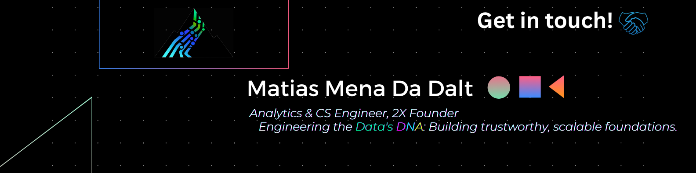
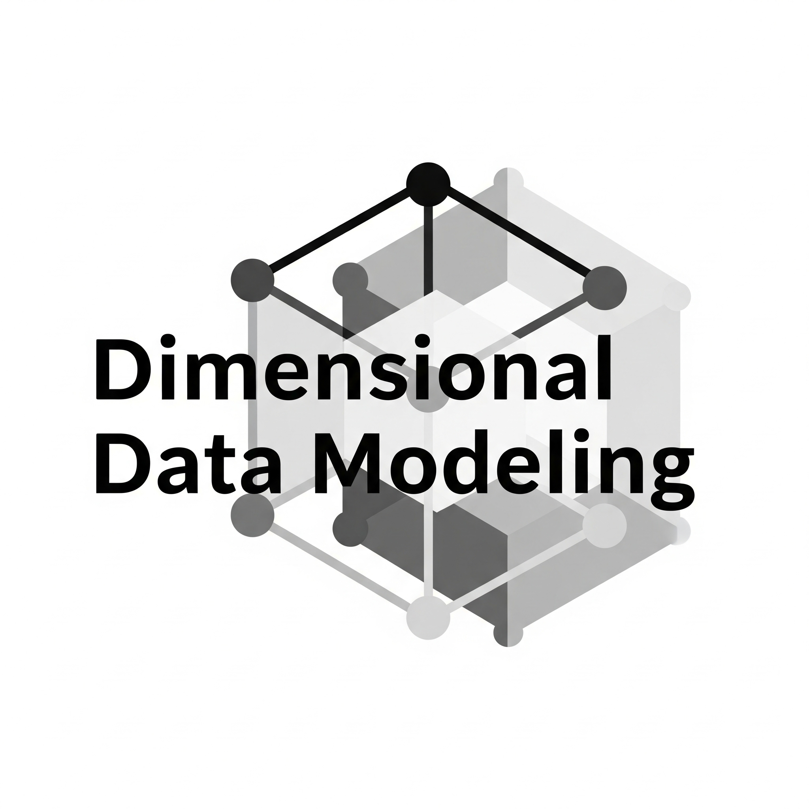
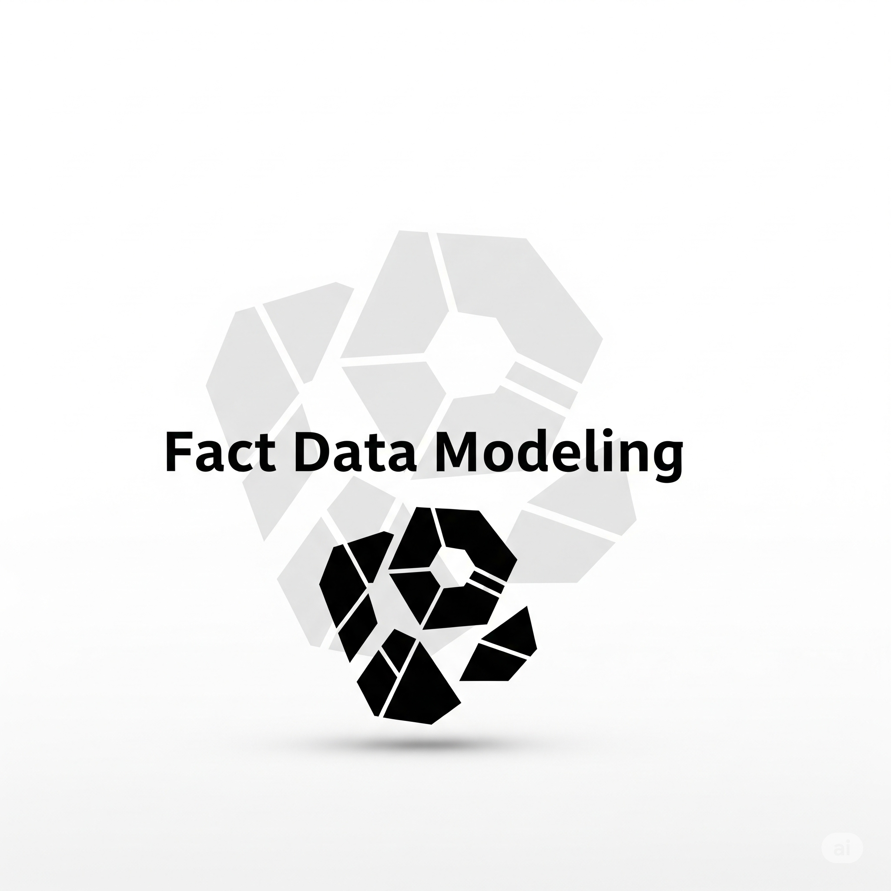
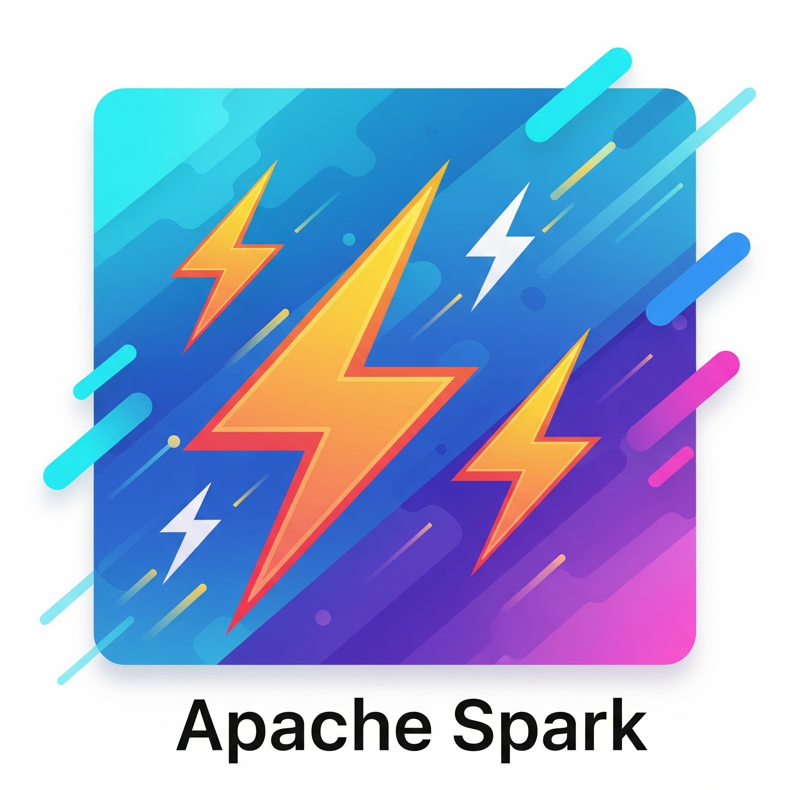
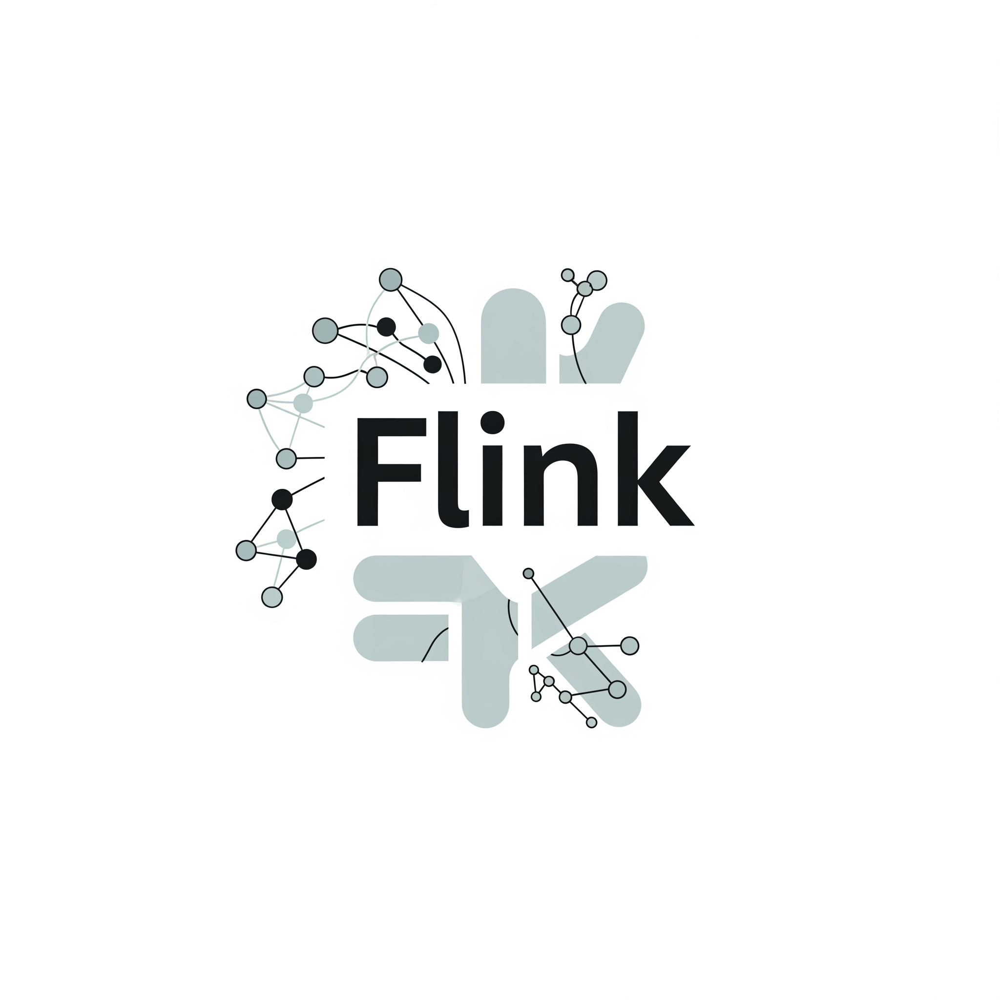

# 👋 Hi, I'm Matias

🏛️ Founder of **[Moducity](https://moducity.space)** at **Keystone Analytics Group**: a GovTech platform that takes municipal building permits from paper to fully digital, legally signed case files.

📊 Background in **Data Engineering**: I build software the way I build pipelines: event-driven, observable and designed around the data.

---

## 📚 Table of Contents

* [🏛️ What I'm Building: Moducity](#️-what-im-building-moducity)
* [🛠️ Toolkit](#️-toolkit)
* [✨ How I Work](#-how-i-work)
* [💻 Data Engineering Projects](#-data-engineering-projects)
* [🌟 GitHub Activity](#-github-activity)
* [🔗 Connect With Me](#-connect-with-me)

---

## 🏛️ What I'm Building: Moducity

**Moducity** manages *expedientes de obras particulares* (building-permit case files) for Argentine municipalities, from the professional's first submission through plan approval (*visado*), inspections and the final certificate of completion. It is in production with the **Municipalidad de Trevelin** and the **Municipalidad de Esquel** (Chubut), with more municipalities on the way.

* **Multi-tenant by design:** one shared platform, with each municipality configuring its own procedures, roles, fees and document templates.
* **Configurable workflows:** different procedure types (new construction, regularization of existing buildings, change of professional, sewer connections) each follow their own approval path.
* **Legally valid digital signatures:** officials sign permits, plan approvals and inspection reports with Argentine *Firma Digital*, including batch signing of plan sheets.
* **Serverless on AWS:** a Next.js front end over Lambda (arm64), DynamoDB, S3, Cognito and Step Functions, all managed as code with Terraform.

---

## 🛠️ Toolkit

### Building Moducity (daily)

### Data Engineering

### Exploring

---

## ✨ How I Work

* **Domain first.** Municipal procedures have their own language (*expediente*, *visado*, *refrendo*). I model the software on that language, not the other way around.
* **Business thinking.** Every feature has to save a real official or professional real time.
* **Pragmatic and clean.** Ship small, test it, keep it readable.
* **Built to be trusted.** Least-privilege access, auditable history and legally valid signatures, because public records depend on it.

Concepts I keep coming back to: event-driven architecture · multi-tenancy · domain-driven design · data modelling · infrastructure as code · CI/CD · observability · data quality.

---

## 💻 Data Engineering Projects

<table align="center">
  <tr>
    <td align="center">
      <a href="https://github.com/Matias0-git/dimensional_data_modeling_w1_zb" target="_blank">
        
         
        <b>Dimensional Data Modeling</b>
      </a>
    </td>
    <td align="center">
      <a href="https://github.com/Matias0-git/fact_data_modeling_w2_zb" target="_blank">
        
         
        <b>Fact Data Modeling</b>
      </a>
    </td>
  </tr>
  <tr>
    <td align="center">
      <a href="https://github.com/Matias0-git/apache_spark_w3_zb" target="_blank">
        
         
        <b>Apache Spark</b>
      </a>
    </td>
    <td align="center">
      <a href="https://github.com/Matias0-git/apache_flink_and_analiytical_patterns_w4_w4bis_zb" target="_blank">
        
         
        <b>Apache Flink & Analytical Patterns</b>
      </a>
    </td>
  </tr>
</table>

---

## 🌟 GitHub Activity

---

## 🔗 Connect With Me

  

Working on GovTech, digital public services or a municipality that still runs on paper? Let's talk.
